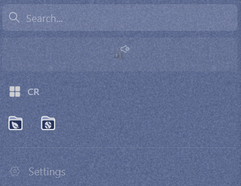

# Compact Folders

Turns closed folders in Zen's sidebar into small icon-only tiles that wrap side by side, so a stack of folders takes a row or two instead of a whole column.



- Closed folders (with no active tab inside) become small tiles in a row.
- Hovering a tile shows the folder's name in a pill under it.
- Opening a folder, or a folder that holds the active tab, goes back to a full-width row so its tabs have room.
- Only applies when the sidebar is expanded; compact mode is left alone.

## Settings

Edit the variables at the top of `chrome.css`:

| Variable | Default | Controls |
| --- | --- | --- |
| `--cf-tile-width` | `40px` | Width of each folder tile |
| `--cf-tile-gap` | `4px` | Space between tiles |
| `--cf-tile-bg` | 7% of the text color | Tile background |

## Folder colors (optional)

You can give a folder its own icon color by its exact name. Uncomment the examples at the bottom of `chrome.css` and change the names to match your folders:

```css
zen-folder[label="Work"] { --cf-color: #4c8dff; }
```

Names are case-sensitive. If you rename a folder, update it here too. Folders not listed keep the space's default color.

## Install

Download `compact-folders.css` from the [latest release](https://github.com/mcastae813/zen-mods/releases), or use `chrome.css` from this folder, then follow [Installing a mod](../README.md#installing-a-mod).

## Known issues

- The layout misbehaves when several open folders sit next to closed ones.

---

Made with Claude Opus, Anthropic's AI model.
